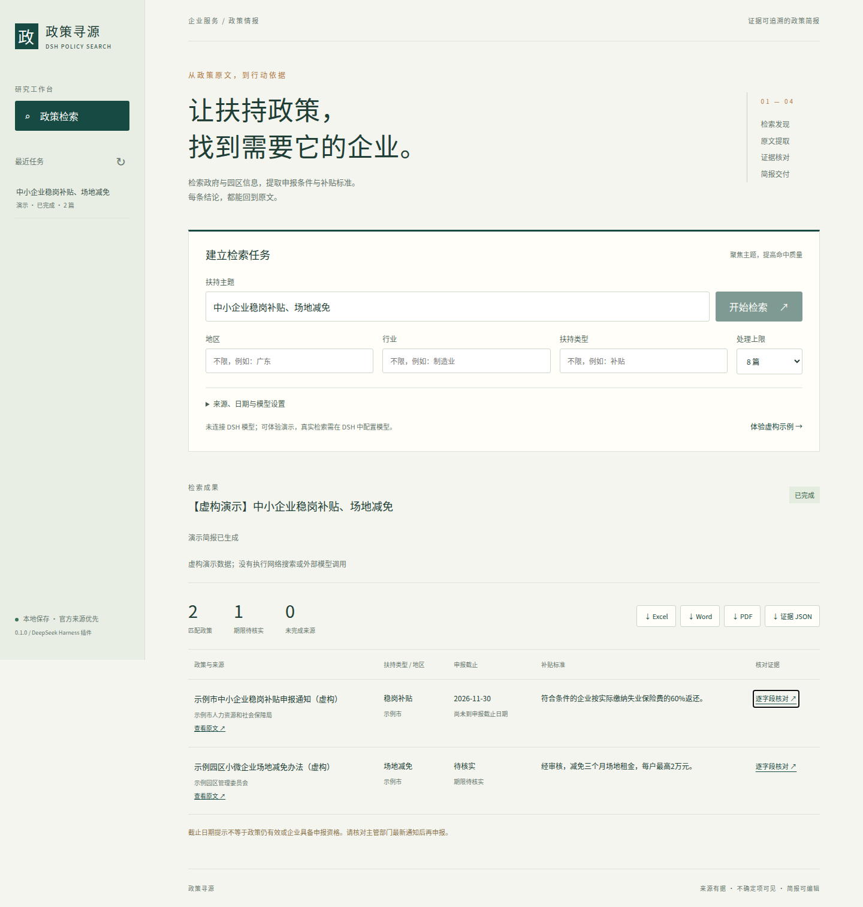

# 政策寻源 · DSH Policy Search

面向企业服务人员的 **DeepSeek Harness 插件**：检索政府、园区及政务平台的企业扶持政策，抓取 HTML / 文字 PDF，提取申请条件、申报期限、补贴标准，生成带原文证据的 XLSX、DOCX、PDF 简报。

按照《AI政策搜索智能体》需求实现，参考 [policy-search-china-skill](https://github.com/dongwei6688/policy-search-china-skill) 的检索与原文溯源思路。新增图形工作台、宿主模型集成、字段证据校验、任务历史/取消、去重、办公导出和开源制作技能。没有复制该项目的缓存库或执行代码。



## 安装到 DSH

当前版本 **0.1.1**，验证基线为 **DeepSeek Harness 0.2.1-rc.2、Node.js 24**。本版明确要求 `@deepseek-ai/dsh-tools@0.2.1-rc.2`，不扩大到未验证的宿主版本；旧 DSH 0.2.0-rc.2 请继续使用插件 0.1.0。

1. 从本私密仓库的 Release 下载 `dsh-policy-search-0.1.1.tgz`。
2. 用 DSH 自带的终端和 Node 环境安装本地包（将示例改成真实绝对路径）：

   ```sh
   dsh plugin --profile web add /absolute/path/dsh-policy-search-0.1.1.tgz
   ```

   Windows 也支持带引号的路径，例如 `"F:\Downloads\dsh-policy-search-0.1.1.tgz"`。首次安装需要访问 npm 安装依赖，不依赖 npm 私有仓库，也不会发布到 npm。
3. 重启对应 DSH profile。在 DSH 中配置模型；如果需要搜索引擎发现候选，也配置一个 DSH 网页搜索提供商。
4. 在对话中说：**“打开政策寻源工作台”**。`policy_workbench` 返回仅供本机使用的带访问凭据链接。打开后选择模型、主题、地区和来源，点击“开始检索”。

插件自动注册 `policy-search` 与 `policy-office` 两个技能，以及 `policy_workbench`、`policy_search`、`policy_job`、`policy_office` 四个工具。不会替换宿主模型配置、读取或迁移用户密钥。

如果没有网页搜索服务，会明确提示并扫描选中的官网目录；可直接粘贴具体政策网址。目录扫描的覆盖范围有限，不能替代全网搜索。

### 从 0.1.0 更新

DSH 0.2.1-rc.2 的插件页若提示旧包不兼容，先停用并卸载 **dsh-policy-search@0.1.0**，再用该页的本地安装入口安装新的 TGZ，并按提示重启。CLI 可在同一个 profile 中执行：

```sh
dsh plugin --profile web remove dsh-policy-search
dsh plugin --profile web add /absolute/path/dsh-policy-search-0.1.1.tgz
```

卸载前记下插件的自定义配置，安装后恢复原值；不要删除 `$DSH_HOME/policy-search`（或原先设置的 `dataDir`）。本次升级不改变任务 JSON、数据路径、工具名或技能名。无需设置版本豁免或关闭兼容性检查。npm 的 `latest` 标签可能仍指向旧版 DSH，开发依赖按已验证的候选版精确锁定。

## 工作台与输出

- **可核对的提取**：政策名称、发布机关、地区、层级、行业、类型、申请条件、申报截止日期、补贴标准、发布日期、有效期和效力说明。每个字段保留原文证据；证据不在正文中则置空或替换为真实摘录。
- **日期不混用**：发布日期、政策有效期和申报截止日期独立；完整日期缺失、多批次或另行通知时标记“待核实”。尚未截止不等于政策仍有效或企业符合申报条件。
- **任务可靠性**：单实例最多同时 2 个任务、每任务 1–30 篇；有取消、限时、限量重试、失败来源记录；失败结果不会标记为全部成功。任务在本机 JSON 中保存，重启后正在运行的任务标记中断。
- **真实办公文件**：XLSX 含阅读说明、政策汇总、字段证据、未完成来源四张表；DOCX 可编辑并带原文链接；PDF 嵌入开源中文字体；JSON 包括来源正文、模型输入输出和抓取记录。
- **明确区分演示**：内置两条虚构政策，可不使用模型/网络体验流程。界面及导出文件均标记“虚构演示”，不与真实结果混合。

## 开源 XLSX / Word / PDF 制作技能

已集成 [magnus919/agent-skills 的 documents 技能](https://github.com/magnus919/agent-skills/tree/2e8fb962819b2b01b270620f92f0cc7213d77ef1/documents)（MIT），固定版本并保留原始 Excel、Word、PDF 参考、模板、结构校验器和许可。

`skills/policy-office/SKILL.md` 是 DSH 适配入口。通过 `policy_office(action="guide", format="xlsx"|"docx"|"pdf")` 按需加载；`action="export"` 调用已安装的 Node 导出器。**生成文件不需要 Python、Office、LibreOffice 或浏览器**。上游 Python 校验器仅供开发验收；不会因为技能里提到其他技能而自动安装它们。

原始技能及 SHA-256 记录见 `skills/policy-office/upstream-lock.json`。具体许可、中文字体和独立实现边界见 [NOTICE.md](NOTICE.md)。

## 配置

通常无需配置。需要指定园区/政务平台域名、数据目录或端口时，在对应 profile 的 `cordis.patch.yml` 中修改已安装的 `policy-search` 行，使用 DSH 的标准配置编辑方式。不要重复插入同 ID，也不要覆盖整个配置文件。

插件配置值示例（这是该插件的 `config` 对象，不是完整 patch 文件）：

```yaml
dataDir: /absolute/path/policy-data
port: 0
allowedHosts:
  - park.example.cn
dnsResolver: system
```

`allowedHosts` 是**精确域名**清单，默认只允许 `gov.cn` 及其子域名。自定义域名也会接受公共地址校验；本机、内网、元数据地址、带用户名密码及非标准端口均拒绝。重定向逐跳检查，遵循 robots.txt，保留 HTTPS 证书验证，不绕过登录/验证码。

默认系统 DNS。在代理把公网域名映射为 `198.18.*` 等非公共地址的环境，可显式设置 `dnsResolver: alidns`，使用 `https://dns.alidns.com/resolve` 的公共 DNS-over-HTTPS，核对返回地址后固定连接。仅向解析服务发送目标域名，不发送检索主题/正文；不会直接放行假 IP 或修改操作系统 DNS。该选项是当前环境真实抓取验证所使用的设置。

默认数据目录为 `$DSH_HOME/policy-search`，未定义时为用户主目录 `.dsh/policy-search`。搜索主题、政策原文与模型请求/响应会持久保存；不保存 API Key。模型提取会把政策正文发送给用户选定的宿主模型，可能计费。网页搜索也可能按宿主服务计费。

## 本地体验和开发

```sh
npm ci
npm run demo
```

打开终端输出的工作台地址。独立 CLI 只演示数据；真实模式通过 DSH 使用宿主提供商。浏览器链接含本地令牌，请勿对外分享。服务仅监听 `127.0.0.1`，不会创建计划任务或常驻系统服务。

```sh
npm run check
npm test
node scripts/demo-artifacts.js
python3 skills/policy-office/upstream/scripts/validate-documents.py --json output/verification/政策简报-虚构演示.xlsx output/verification/政策简报-虚构演示.docx output/verification/政策简报-虚构演示.pdf
npm run pack:release
```

Windows/Linux 演示启动脚本在 `Start-Demo.cmd` 和 `start-demo.sh`。依赖已安装时直接运行；首次按上方 `npm ci` 安装。

## 验收范围与限制

见 [设计与需求映射](docs/DESIGN.md)、[部署与操作](docs/DEPLOYMENT.md)、[0.1.1 兼容性验证](docs/VERIFICATION-0.1.1.md) 和 [0.1.0 原始验证记录](docs/VERIFICATION.md)。

本版是可安装的 DSH 插件与可运行的演示程序，不是独立 Windows EXE。没有全量政策库、后台持续监控、自动申报或自动判定最终法律效力。扫描 PDF OCR、必须执行 JavaScript/登录才能读取的网页会明确失败。中国政府网站的可达性、反爬和模型准确率需在实际部署持续关注；单次有限检索不能承诺“全国所有最新政策”。
